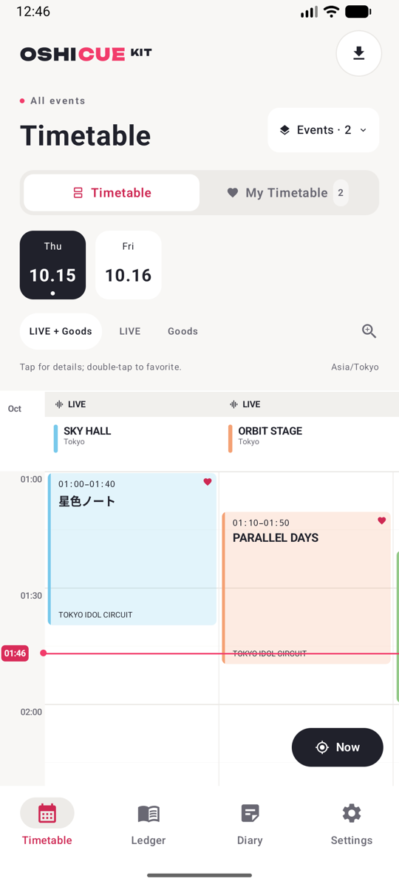
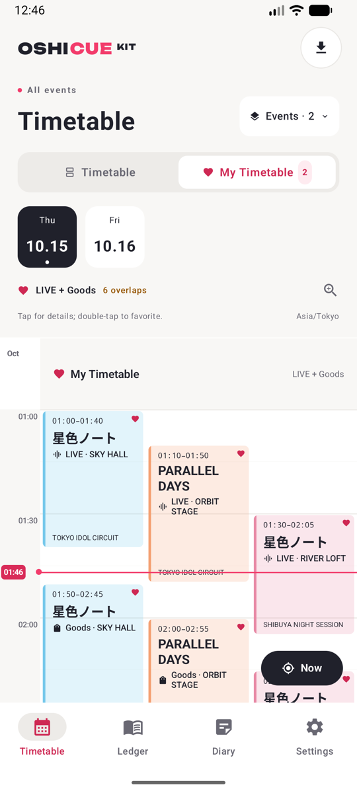
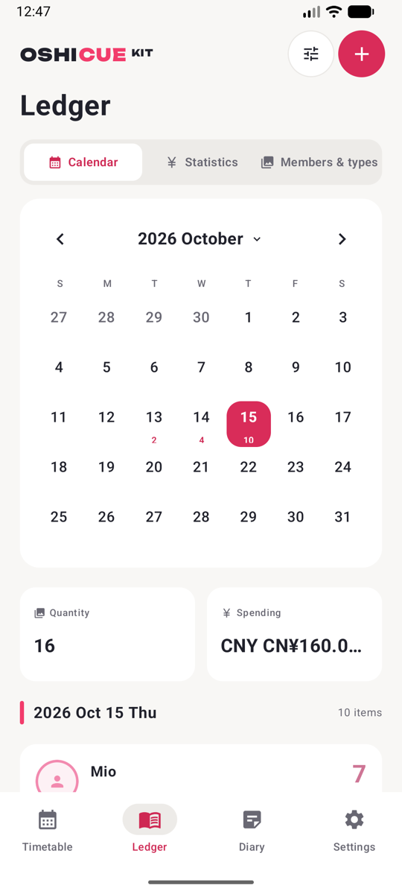
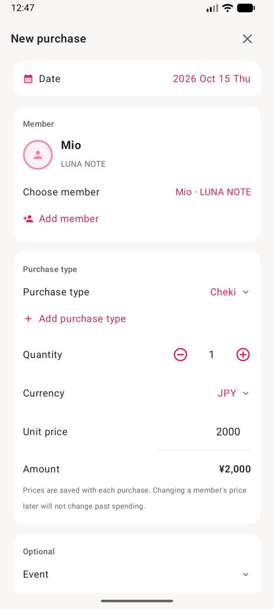
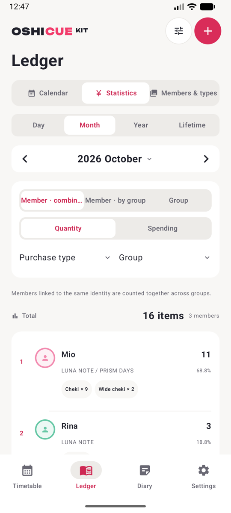
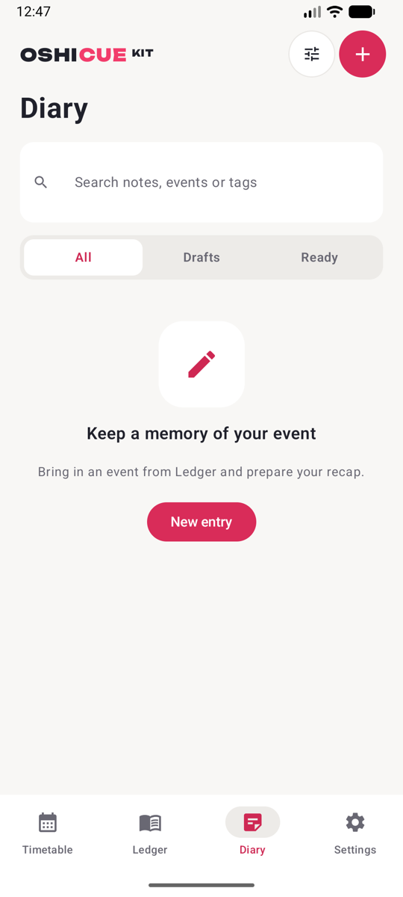
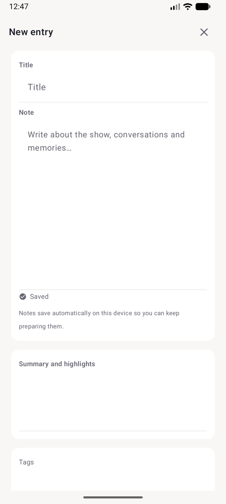
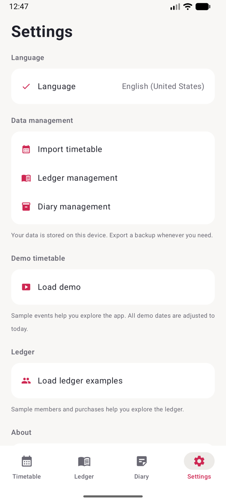

# Oshicue Kit for Android

[简体中文](README.md) | [繁體中文](README.zh-Hant.md) | [繁體粵語](README.zh-HK.md) | [English](README.en.md) | [日本語](README.ja.md) | [한국어](README.ko.md) | [ไทย](README.th.md) | [Bahasa Indonesia](README.id.md) | [Bahasa Melayu](README.ms.md)

原生 Android 應用程式（Kotlin + Jetpack Compose），用於查看活動時間表、記錄物販消費和整理活動日誌。四個分頁依序為時間表、手帳、日誌、設定。目前版本為 **0.4.0（versionCode 10）**，與 iOS 版 Oshicue Kit 0.4.0（build 10）功能對齊，支援 Android 8.0（API 26）以上。

## 截圖

| 時間表 | 我的行程 | 手帳日曆 |
| --- | --- | --- |
|  |  |  |

| 新增物販 | 手帳統計 | 日誌 |
| --- | --- | --- |
|  |  |  |

| 新增日誌 | 設定 |
| --- | --- |
|  |  |

## 功能

### 時間表

- 全部行程按場館和 LIVE／物販分區；日期、活動多選與類型篩選可組合使用。橫向查看場館，縱向查看時間。
- 單擊場次查看完整詳情；雙擊收藏或取消收藏團體。收藏按 `artistID` 跨活動共享；「我的行程」合併顯示收藏團體的 LIVE 與物販場次，重疊時並排顯示並提示衝突。
- 時間軸提供 50%、70%、100%、150% 縮放（預設 100%，即 4dp／分鐘），並發較多時橫向擴寬，短場次優先顯示名稱並自動縮放字級，詳情保留完整資料。
- 目前時間線使用真實系統時間，每 15 秒更新；「現在」僅在所選活動有今天排期時切換到今天。
- 多活動統一使用文件順序中首個所選活動的時區；詳情可查看原活動當地時間；跨午夜場次按展示時區拆分到相應日期。
- 匯入支援貼上 JSON 或選擇一個／多個 UTF-8 JSON 檔案，先校驗和預覽，再確認套用；相同活動 ID 整體取代該活動，其餘保留，同批重複活動 ID 會被拒絕。刪除時間表需確認，並清理不再屬於任何剩餘活動的收藏。

### 手帳

- 日曆查看每日與每月數量及分幣別金額；點選成員卡片編輯物販，多筆記錄先選擇再編輯。
- 管理團體、成員、頭像、各團體身份的代表色與預設價格、物販類型與活動範本；兼任成員透過關聯已有成員新增身份。
- 記錄日期、成員與團體、類型、數量、幣別、單價及可選的活動資訊，也可從時間表帶入活動資料。
- 排行榜按日／月／年／生涯，支援數量或消費、成員合計／成員分團／團體、類型與團體篩選；並列名次為 `1、1、3`；消費選擇單一幣別，不做匯率換算。
- 歷史記錄保存名稱、顏色、活動與價格快照；刪除成員／團體為封存語意，歷史記錄與統計保留且仍可編輯。
- 成員可標記「最愛成員」，記錄成員選擇頁置頂顯示；金額使用整數最小貨幣單位，支援 `CNY`、`JPY`、`HKD`、`TWD`、`USD`、`KRW`、`THB`、`IDR`、`MYR`。
- 手帳管理提供記錄管理（按日期範圍、成員、團體、類型、幣別、活動與文字組合篩選後批次刪除、刪除全部）、資料清理（封存成員／團體）與 JSON 備份（匯出、匯入預覽、衝突拒絕）。

### 日誌

- 新增活動 repo，編輯標題、內文、摘要和標籤，標記為「草稿」或「已整理」；按活動日期瀏覽、按狀態篩選、搜尋內文與活動資料。
- 可從手帳活動帶入日期、名稱、城市、場館與地址，再獨立修改；日誌保存自己的快照。
- 停止編輯約 0.5 秒後自動儲存；關閉編輯器或進入背景立即提交；儲存失敗可重試。
- 「準備發布」可複製 Markdown／純文字、匯出 `.md`／`.txt` 或呼叫系統分享。
- 日誌管理提供篩選、批次刪除與 JSON 備份匯入匯出。

### 設定與資料

- 語言切換（9 種語言 + 跟隨系統）即時生效；日期、時間與數字按所選地區格式化。
- 時間表匯入、手帳管理、日誌管理、範例載入與版本資訊統一入口。
- 三個模組獨立保存在本機 `files/OshicueKit/` 下的 `schedule.json`、`ledger.json`、`diary.json`，原子寫入；核心功能離線可用。

## 建置與執行

需求：

- JDK 17 以上（建議使用 Android Studio 自帶的 JBR 或 JDK 21+）
- Android SDK Platform 37 與 Build-Tools 36（Android Studio 可自動安裝）
- 在儲存庫根目錄建立 `local.properties` 寫入 `sdk.dir=/path/to/Android/sdk`，或設定 `ANDROID_HOME` 環境變數
- 首次建置需要網路存取 Maven 儲存庫；Gradle Wrapper 會自動下載對應版本

```sh
./gradlew :app:assembleDebug        # 建置偵錯 APK
./gradlew :app:installDebug         # 安裝到已連接的裝置或模擬器
./gradlew :app:testDebugUnitTest    # 93 項單元測試（與 iOS 單元測試一一對應）
./gradlew :app:lintDebug            # 靜態檢查
./gradlew :app:assembleRelease      # 建置發布 APK
```

### 發布簽名

儲存庫不包含簽名素材。若要產出可安裝、可散佈的發布 APK，請在儲存庫根目錄建立 `keystore.properties`（該檔案與 `*.jks` 已在 `.gitignore` 中排除）：

```sh
keytool -genkeypair -v -keystore oshicue-kit-release.jks -alias oshicue-kit \
  -keyalg RSA -keysize 2048 -validity 10000
```

```properties
storeFile=oshicue-kit-release.jks
storePassword=你的密碼
keyAlias=oshicue-kit
keyPassword=你的密碼
```

然後執行 `./gradlew :app:assembleRelease`，輸出位於 `app/build/outputs/apk/release/app-release.apk`（未設定 `keystore.properties` 時輸出未簽名 APK）。請妥善備份 `oshicue-kit-release.jks` 與密碼，後續版本需使用同一簽名。

## 資料格式與相容性

- 三個模組的 JSON 格式與 iOS 版完全一致（`schemaVersion` 為 `1`），應用程式內匯出／匯入的備份檔案可與 iOS 版互相使用；本機資料檔案結構也相同。
- 時間戳使用帶毫秒的 ISO 8601（`yyyy-MM-ddTHH:mm:ss.SSSZ`）；日期為公曆 `yyyy-MM-dd`；金額為整數最小貨幣單位（`unitPriceMinor`）。
- 匯入一律先校驗、預覽，再確認套用；同 ID 不同內容的記錄會拒絕整次匯入，避免覆寫歷史。
- `Templates/` 與 `docs/` 沿用 iOS 版的格式範本與說明文件，可直接參考。

## 本地化

內建簡體中文、繁體中文（台灣）、繁體粵語（香港）、English、日本語、한국어、ไทย、Bahasa Indonesia、Bahasa Melayu 共 9 種語言，資源位於 `app/src/main/res/values-*/strings.xml`。

`tools/convert_localization.py` 用於從 iOS 版的 `Localizable.strings` 重新產生本儲存庫的語言資源（含 `%@` → `%1$s` 位置化參數轉換）。如果只維護 Android 版，直接編輯對應的 `strings.xml` 即可。

## 目錄結構

| 路徑 | 內容 |
| --- | --- |
| `app/src/main/kotlin/com/oshicue/kit/core/` | 模型、JSON 匯入匯出、統計與排行、時間軸版面演算法 |
| `app/src/main/kotlin/com/oshicue/kit/data/` | 三個獨立 Store、原子寫入與復原備份 |
| `app/src/main/kotlin/com/oshicue/kit/i18n/` | 語言解析與文案查詢 |
| `app/src/main/kotlin/com/oshicue/kit/ui/` | Compose 介面：時間表、手帳、日誌、設定及全部編輯與備份頁面 |
| `app/src/main/res/` | 9 種語言資源、啟動圖示、Unbounded 字型 |
| `app/src/main/assets/` | 內建匯入範本 |
| `app/src/test/` | 單元測試（匯入校驗、幣別精度、排名並列、時間軸演算法、UTF-8 處理等） |
| `tools/` | 本地化資源轉換腳本 |
| `Templates/`、`docs/` | JSON 範本與格式說明（沿用 iOS 版） |

## 與 iOS 版的差異

- 平台元件：檔案匯入匯出使用系統檔案選擇器，頭像使用系統相片選擇器（下採樣到 512px、JPEG 0.8、Base64 儲存，與 iOS 相同），分享使用系統分享面板。
- 無障礙：iOS 的 VoiceOver 自訂動作對應為 Compose 的輕點／雙擊手勢與語意標籤。
- 其餘互動流程、邊界條件與 JSON 資料格式與 iOS 版保持一致。

## 開源授權

專案沿用原專案的 [MIT License](LICENSE)；第三方元件保留各自授權。內建的 Unbounded 字型使用 [SIL OFL 1.1](THIRD_PARTY_NOTICES)，詳見[第三方聲明](THIRD_PARTY_NOTICES)。

Oshicue Kit 原版為原生 SwiftUI iOS 應用程式（0.4.0，build 10），本儲存庫是其 Android 平台的完整移植。
